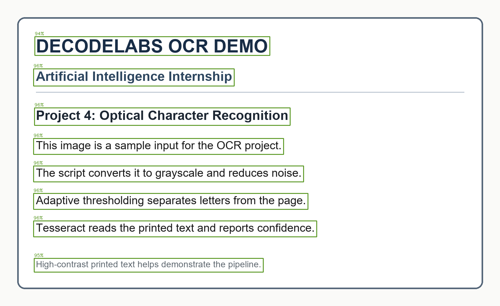

# DecodeLabs AI Internship - Project 4

## Image or Text Recognition: OCR

This project chooses the OCR path from the assignment. It reads printed English
text from an image with Tesseract and OpenCV. The pipeline converts the image to
grayscale, reduces noise with Gaussian blur, applies adaptive thresholding,
corrects small skew angles, then asks the pre-trained Tesseract OCR engine to
recognize the text.

For each image, the program prints the recognized text and average word
confidence. By default it reports `PASS` when the average confidence is at least
80%. It also saves the binary preprocessed image, a copy of the input with
confidence-labeled text-line boxes, and a text report.

## Project files

- `ocr_reader.py` - OCR pipeline, confidence validation, and output generation.
- `sample_input.png` - included high-contrast sample image for the first run.
- `requirements.txt` - OpenCV, pytesseract, and Pillow dependencies.
- `demo/` - saved example output from the included sample.

## Verified sample

The included sample image returned **95.5% average word confidence**, above the
assignment's 80% minimum. The green boxes show the recognized text lines and
their confidence scores.



## Requirements

- Python 3.11 or newer
- Tesseract OCR 5 with English language data
- The Python packages listed in `requirements.txt`

`pytesseract` is a Python wrapper; it does not install the Tesseract program.
For Windows, download and install Tesseract from the [UB Mannheim Tesseract
Windows installer page](https://github.com/UB-Mannheim/tesseract/wiki). Use the
installer's suggested location or a new folder. The program checks the default
`C:\Program Files\Tesseract-OCR\tesseract.exe` location, the current Windows
user's `AppData\Local\Tesseract-OCR` folder, and the PATH. If you use a different
folder, set `TESSERACT_CMD` to the full path of `tesseract.exe`.

## Run on Windows

Open PowerShell in this project folder and run:

```powershell
py -m venv .venv
.\.venv\Scripts\python.exe -m pip install -r requirements.txt
.\.venv\Scripts\python.exe ocr_reader.py
```

The first run uses the included `sample_input.png`. To recognize a different
image, pass its path:

```powershell
.\.venv\Scripts\python.exe ocr_reader.py "C:\path\to\your-image.png"
```

The default OCR page segmentation mode is 6 (one text block). Use `--psm 3` for
automatic layout, `--psm 7` for a single line, or `--psm 11` for scattered text.
The minimum average confidence defaults to 80%; change it with
`--min-confidence 80` if needed.

## Output files

The program creates an `output` folder containing:

- `<image>_preprocessed.png` - grayscale/noise-reduced/adaptively thresholded image.
- `<image>_annotated.png` - recognized line boxes, colored and labeled by confidence.
- `<image>_text.txt` - extracted text and confidence validation result.

The demo output in `demo/` was generated from the included sample image. OCR
confidence is the engine's estimate for recognized words; it is not a guarantee
of perfect transcription. Review the saved text when processing important
documents.
